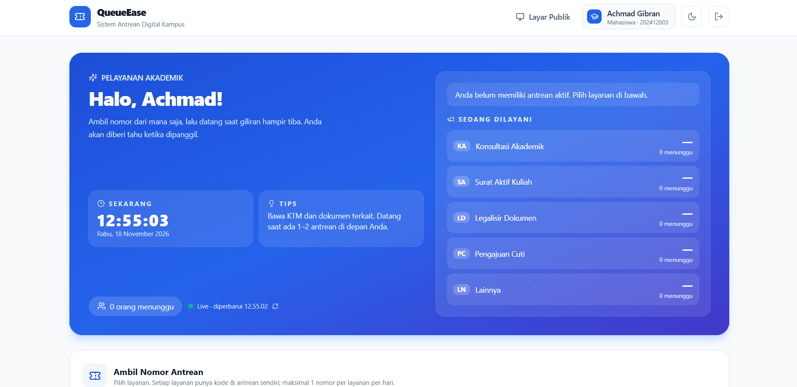
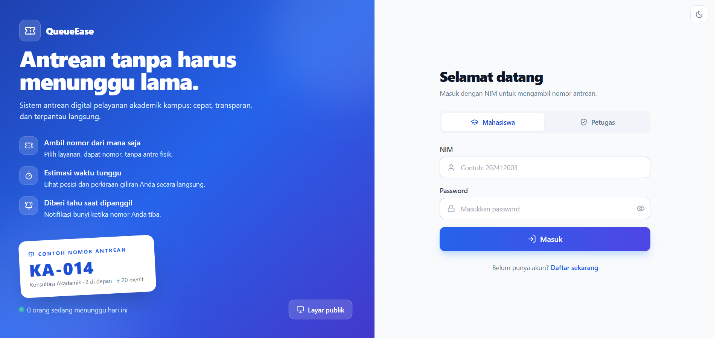
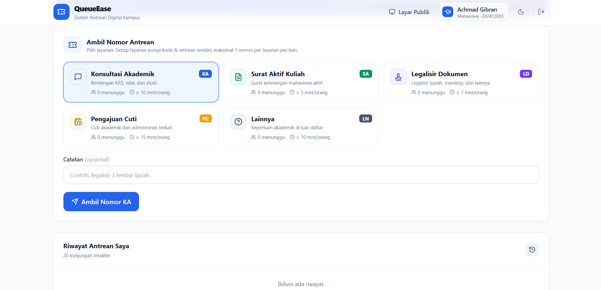
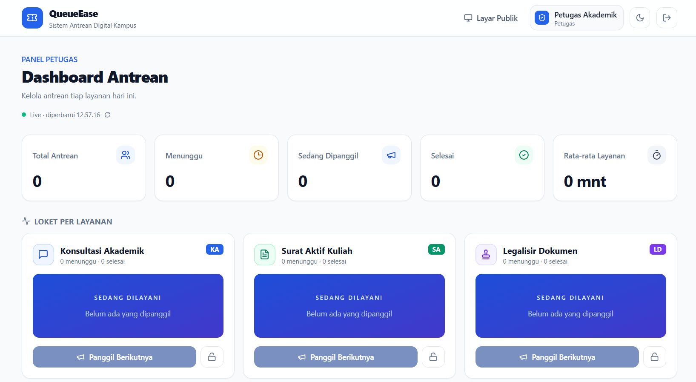
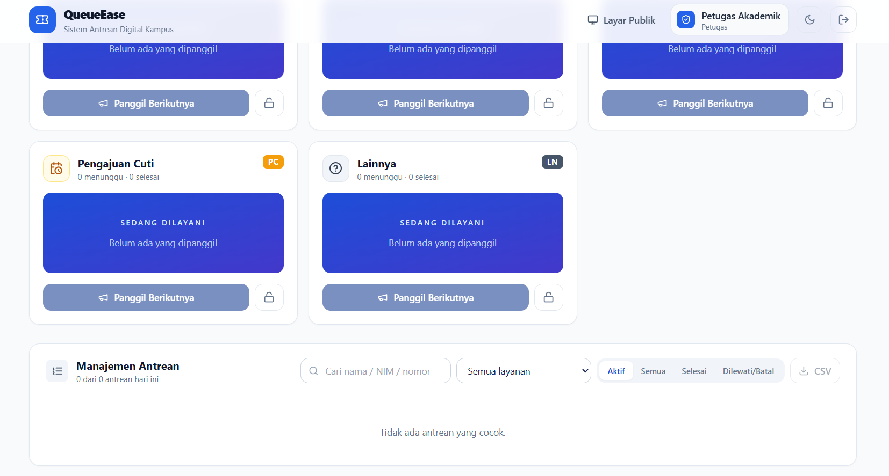
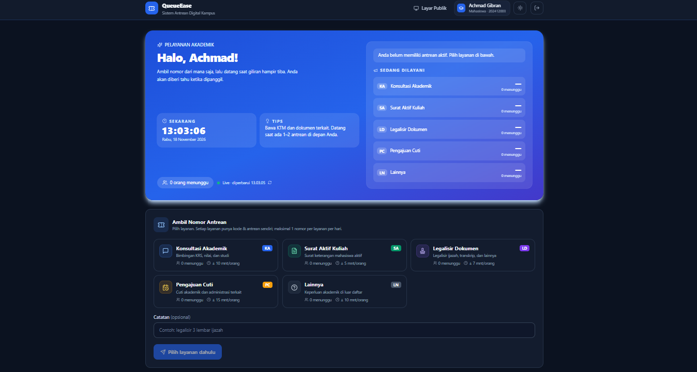

<div align="center">

# 🛎️ QueueEase

**Sistem Antrean Digital Kampus**

Ambil nomor dari mana saja, pantau giliran secara langsung, dan datang saat dipanggil.


[Halaman](#-tampilan-halaman) · [Fitur](#️-fitur) · [Instalasi](#️-cara-menjalankan) · [API](#️-ringkasan-api) · [Tim](#-tim)



</div>

---

## 📸 Tampilan Halaman

| Halaman | Alamat | Role | Fungsi |
|---|---|---|---|
| **Login & Daftar** | `/login` | Publik | Masuk sebagai mahasiswa (NIM) atau petugas (username) |
| **Dashboard Mahasiswa** | `/mahasiswa` | Mahasiswa | Ambil nomor, pantau posisi, batalkan, riwayat |
| **Dashboard Petugas** | `/petugas` | Petugas | Kelola loket, panggil, selesaikan, ekspor CSV |
| **Layar Publik** | `/display` | Publik | Tampilan TV/monitor di ruang layanan |

### Login & Daftar
Satu halaman untuk dua role. Mahasiswa mendaftar dengan **NIM** (unik), petugas masuk dengan username.

<p align="center"></p>

### Mahasiswa
Kartu biru menampilkan nomor Anda, posisi antrean, estimasi tunggu, dan papan "Sedang dilayani" tiap layanan. Di bawahnya, pilih layanan dan ambil nomor.

<p align="center">
  
  
</p>

### Petugas
Satu kartu loket per layanan, statistik hari ini, dan tabel manajemen antrean dengan pencarian, filter, serta aksi panggil, ulang, selesai, dan lewati.

<p align="center">
  
  
</p>

### Layar Publik
Untuk TV/monitor di area pelayanan, tanpa login dan tanpa data pribadi. Tampilannya selalu gelap dan menampilkan jam serta nomor yang sedang dilayani.

<p align="center"></p>

### Mode Gelap
Dashboard mahasiswa dan petugas mendukung mode gelap lewat tombol bulan/matahari di header. Pilihan tersimpan di browser.

<p align="center"></p>

---

## 🎛️ Fitur

| | |
|---|---|
| **Login berbasis role** | `mahasiswa` dan `petugas`, dilindungi di frontend dan backend (JWT + cek role) |
| **NIM unik** | Satu NIM hanya untuk satu akun |
| **Antrean per layanan** | Kode sendiri: `KA` Konsultasi Akademik, `SA` Surat Aktif Kuliah, `LD` Legalisir Dokumen, `PC` Pengajuan Cuti, `LN` Lainnya (contoh nomor `KA-001`) |
| **Notifikasi** | Bunyi dan notifikasi browser saat nomor dipanggil |
| **Alat petugas** | Panggil berikutnya, panggil tiket tertentu, panggil ulang, selesai, lewati, pencarian, filter, ekspor CSV, rata-rata durasi layanan |
| **Tampilan** | Mode gelap, skeleton loading, cache sementara |
| **Realtime ringan** | Data diperbarui otomatis tiap 5 detik (polling) |

<details>
<summary><b>Aturan antrean</b></summary>

- Maksimal **1 nomor per layanan per hari** untuk tiap mahasiswa.
- Maksimal **2 antrean aktif** sekaligus.
- Kuota harian per layanan, dan petugas bisa membuka/menutup layanan.
- Nomor dibatalkan tidak dihitung; nomor dilewati (tidak hadir) tetap dihitung.
- Antrean tiap layanan terpisah karena lama proses tiap layanan berbeda.

</details>

---

## 🗃️ Struktur Proyek

```
queueease/
├── backend/
│   └── src/
│       ├── config/         koneksi database
│       ├── middleware/     autentikasi JWT dan role
│       ├── routes/         auth, layanan, queue
│       ├── scripts/        seed akun petugas
│       ├── utils/          fungsi bantu
│       └── server.js
├── frontend/
│   └── src/
│       ├── components/     komponen UI
│       ├── context/        sesi login
│       ├── hooks/          polling
│       ├── pages/          Login, Mahasiswa, Petugas, Display
│       ├── services/       pemanggil API
│       ├── utils/          cache, notifikasi, layanan
│       ├── App.jsx
│       └── main.jsx
├── database/
│   └── schema.sql          skema dan data awal layanan
├── gambar/                 tangkapan layar untuk README
└── README.md
```

---

## 🕹️ Cara Menjalankan

**Prasyarat:** [Node.js LTS](https://nodejs.org/) dan akun [Supabase](https://supabase.com/). Tidak perlu memasang PostgreSQL lokal.

### 1. Database
1. Buat project baru di Supabase.
2. Buka **SQL Editor > New query**, tempel seluruh isi `database/schema.sql`, lalu **Run**.
3. Pastikan tabel `users`, `layanan` (5 baris), dan `antrean` muncul di **Table Editor**.
4. Ambil connection string di **Connect > Session pooler > URI**. Jika password memuat karakter khusus (`@`, `#`, `/`, `:`), gunakan URL-encoding.

### 2. Backend
```bash
cd backend
npm install
cp .env.example .env      # Windows CMD: copy .env.example .env
```
Isi `backend/.env`:
```env
PORT=5000
DATABASE_URL=postgresql://...URI_DARI_SUPABASE...
JWT_SECRET=teks-acak-minimal-16-karakter
APP_TIMEZONE=Asia/Makassar
CORS_ORIGIN=http://localhost:5173
ADMIN_USERNAME=petugas
ADMIN_PASSWORD=ganti-password-ini
ADMIN_NAME=Petugas Akademik
```
```bash
npm run seed:petugas
npm run dev
```
Cek `http://localhost:5000/api/health`, hasilnya harus berstatus `ok`.

### 3. Frontend
Buka terminal baru:
```bash
cd frontend
npm install
npm run dev
```
Buka `http://localhost:5173`.

### Uji alur
1. Di `/login`, pilih **Mahasiswa**, lalu **Daftar** (NIM, nama, password).
2. Pilih layanan dan **Ambil Nomor** (misal `KA-001`).
3. Di jendela incognito, login sebagai **Petugas**.
4. Klik **Panggil Berikutnya**; mahasiswa menerima notifikasi.
5. Klik **Selesai**, atau **Lewati** bila tidak hadir.

---

## 🛰️ Ringkasan API

<details>
<summary><b>Lihat daftar endpoint</b></summary>

| Method | Endpoint | Akses | Fungsi |
|---|---|---|---|
| POST | `/api/auth/register` | Publik | Daftar mahasiswa |
| POST | `/api/auth/login` | Publik | Login mahasiswa/petugas |
| GET | `/api/auth/me` | Login | Validasi sesi |
| GET | `/api/layanan` | Publik | Papan layanan dan nomor dilayani |
| PATCH | `/api/layanan/:id/aktif` | Petugas | Buka/tutup layanan |
| GET | `/api/queue/me` dan `/me/riwayat` | Mahasiswa | Tiket saya dan riwayat |
| POST | `/api/queue` | Mahasiswa | Ambil nomor |
| PATCH | `/api/queue/:id/cancel` | Mahasiswa | Batalkan tiket |
| GET | `/api/queue` dan `/stats` | Petugas | Daftar antrean dan statistik |
| PATCH | `/api/queue/call-next`, `/:id/call`, `/:id/recall` | Petugas | Memanggil |
| PATCH | `/api/queue/:id/done` dan `/:id/skip` | Petugas | Selesai / lewati |

</details>

---

## 🧹 Reset Data

Untuk membersihkan data sebelum demo. Jalankan di Supabase SQL Editor; akun petugas dan layanan tetap ada.
```sql
TRUNCATE TABLE public.antrean RESTART IDENTITY;
DELETE FROM public.users WHERE role = 'mahasiswa';
UPDATE public.layanan SET aktif = true;
```

---

## 🔐 Keamanan

- Password di-hash (bcrypt), dan login/daftar dibatasi rate limiting.
- `backend/.env` tidak boleh diunggah ke GitHub (diabaikan lewat `.gitignore`).
- RLS aktif pada tabel Supabase sehingga tidak bisa dibaca lewat REST API publik Supabase.
- Ganti `ADMIN_PASSWORD` dan gunakan `JWT_SECRET` yang acak sebelum dipublikasikan.

---

## 🩺 Troubleshooting

<details>
<summary><b>Lihat masalah umum</b></summary>

| Masalah | Solusi |
|---|---|
| `DATABASE_URL belum diatur` | Pastikan file bernama `.env` (bukan `.env.example`) ada di `backend` |
| `JWT_SECRET belum diatur` | Isi `JWT_SECRET` minimal 16 karakter di `backend/.env` |
| `password authentication failed` | Cek password dan URI Supabase |
| `ENOTFOUND` / timeout | Cek internet, host, port, dan mode pooler pada URI |
| `EADDRINUSE 5000` | Port 5000 dipakai aplikasi lain |
| `Network Error` di browser | Pastikan backend berjalan di `http://localhost:5000` |
| Layar putih / error JSX | Pastikan file yang berisi JSX berekstensi `.jsx` |

</details>

---

## 🧑‍🤝‍🧑 Tim

<div align="center">

**Praktikum Pemrograman Berbasis Framework, STITEK**

| Nama | NIM |
|---|---|
| Muhammad Ikbal | 202412008 |
| Achmad Gibran | 202412003 |
| Mosyarofah | 202412032 |
| Vanesa Gladisya Mamanua | 202412021 |
| Sarmila | 202312080 |

</div>